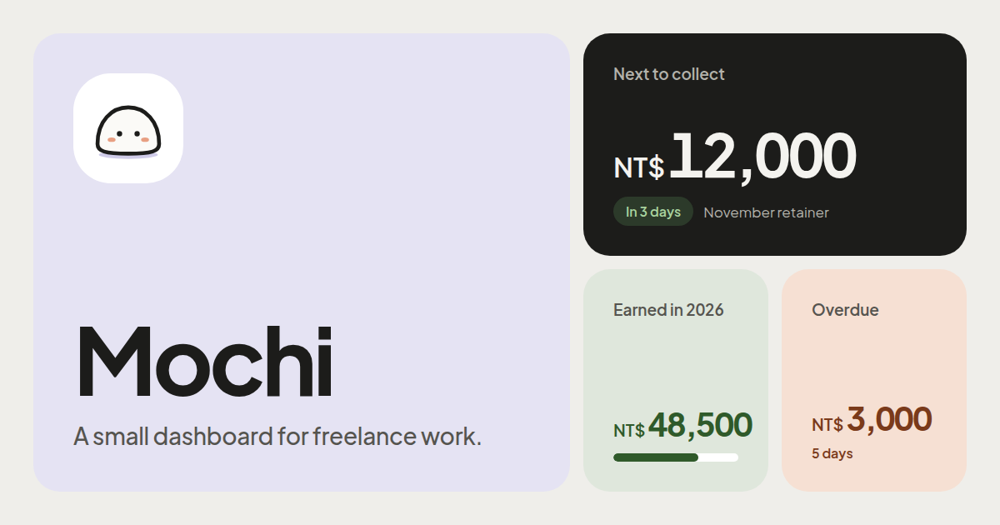

# Mochi

Mochi is a small personal dashboard I made for myself for freelance work.

Try it at [demo.mochi.seria.moe](https://demo.mochi.seria.moe) with the password `mochi`. The demo's data is made up and resets every day, and Discord, Keni and notifications in the Android app are off there.



## Features

- **Projects**: track each project, its price and paid additions, and what's been paid.
- **Clients**: keep their contact methods (Discord, LINE, email) and message them in one click.
- **Retainers**: monthly maintenance fees, with reminders on Discord, in the Android app or both when it's time to collect.
- **Overview**: what to collect next, what's overdue, and what you've earned this year.
- **Stats**: charts, comparisons and tables of what you've earned, from whom, and how projects and retainers are going, by period, client and source.
- **MCP**: let AI assistants like Claude use the dashboard.
- **Keni sync**: record the money you receive as income in [Keni](https://keni.seria.moe).
- **Installable**: works as an app on your phone, in light or dark mode, or as an [Android app](#android-app) with notifications.

## Development

Requires Docker, [uv](https://docs.astral.sh/uv/) and [bun](https://bun.sh/).

```sh
docker compose up -d db              # PostgreSQL on localhost:5433

cd backend
cp .env.example .env                 # then set AUTH_PASSWORD_HASH, ENCRYPTION_KEY, and COOKIE_SECURE=false
uv run python -m app.passwords hash-password
uv run alembic upgrade head
uv run uvicorn app.main:app --reload # API on localhost:8000

cd frontend
bun install
bun run dev                          # app on localhost:5173, proxies /api to the backend
```

Or run both servers with `./dev.sh`. `./dev.sh --demo` needs no setup beyond Docker, uv and bun: it starts the database and runs against a separate `mochi_demo` database, filled with fresh demo data on every run, with the password `mochi`.

Tests: `cd backend && uv run pytest`. Lint and format the backend with `uv run ruff check .` and `uv run ruff format .` (settings in `backend/ruff.toml`), and type-check it with `uv run pyright`. Lint and type-check the frontend with `bun run lint` and `bun run build`.

## Login

The dashboard has one user and a password. `backend/.env` holds only its scrypt hash, `AUTH_PASSWORD_HASH`, printed by `uv run python -m app.passwords hash-password`; without one, nobody can log in. Logging in sets an HttpOnly, SameSite=Lax session cookie that lasts 30 days from the last visit. Setting a new hash logs out every session.

## MCP

AI assistants such as Claude can use the dashboard through MCP at `<API URL>/mcp`, e.g. `http://localhost:8000/mcp` in development. They get tools for clients, projects, maintenance fees, earnings and settings. Add it as a remote (streamable HTTP) MCP server. In Claude Code, for example: `claude mcp add --transport http dashboard https://api.example.com/mcp`.

Clients sign in with OAuth: on connecting, the browser opens a page on the dashboard, after the login screen if needed, that names the client and where access goes. Allow sends the client back with access. Access tokens last an hour and refresh for up to 30 days of disuse. Setting a new password hash ends every client's access, as it does browser sessions. Sign-in requests wait in memory for 10 minutes, so restarting the API drops any that are in progress.

## Keni

Settings can connect [Keni](https://keni.seria.moe), a personal finance tracker, with a Keni URL, a personal API token (Keni's Settings › API tokens), and a wallet and category picked from your Keni account. The money you receive is then recorded there as income: project and addition payments, recorded maintenance payments, and auto transfers once their due date is reached. The wallet and category can be changed later; that applies to income sent from then on. Edits and deletes follow, including payments deleted with their project, client or retainer. Money received before connecting stays out, as does a transaction you delete in Keni.

The API syncs once a minute, in the same loop as the reminders. When Keni can't be reached or refuses a change, Settings shows why and the next minute retries. Amounts are sent as NT$ whatever the wallet's currency. The token is stored encrypted with `ENCRYPTION_KEY`.

## Android app

Mochi has an Android app: the same dashboard from your own server, with the status and navigation bars in the theme's colors, a splash screen in light or dark as picked in Settings, notifications for maintenance reminders, and the Back button (it closes what's open, then goes back).

1. On your phone, download `mochi.apk` from the [latest release](https://github.com/seriaati/mochi/releases/latest) (Android browsers also get a "Get the Android app" button in the dashboard's top bar) and open it. Android asks you to allow installing apps from your browser.
2. The app asks for your Mochi server: enter the dashboard's address, or the API's when they're on separate hosts. It must be HTTPS. The server must run a Mochi version that includes the Android app; given the API's address, the app asks its `/api/health` for the dashboard's.
3. To switch servers later, open **Settings › Android app › Change server**. This logs you out and turns off notifications from the current server; your data on it stays as it is.

**Updates.** When a newer release is out, the app says "A new version of the app is out". Tap **Update**: your browser downloads the new `mochi.apk`; open it and Android installs it over the old app, keeping your login. The app asks GitHub for the latest release when it starts and every 6 hours. Apps like [Obtainium](https://github.com/ImranR98/Obtainium) can also track the Releases page.

**Notifications.** In the app, open **Settings › Notifications** and turn them on; on Android 13 and later, allow notifications when Android asks. Reminders then come to the phone at the same times as on Discord; they go to Discord, the app or both, whichever is set up. **Send test** sends one to every phone that has them on. Tapping a reminder opens Record payment for that client's oldest unpaid month, and a newer reminder for a client replaces the last one. They go through Firebase Cloud Messaging, so Google carries each client's name, amount and contact handle to the phone. The server needs a Firebase project for them, below.

### Firebase for notifications

One APK works with any server: the app gets the Firebase settings from your Mochi once you're logged in. To set them up:

1. In the [Firebase console](https://console.firebase.google.com/), create a project. Google Analytics isn't needed, and the free plan is enough.
2. In **Project settings › General › Your apps**, add an Android app with the package name `moe.seria.mochi` exactly. The nickname and signing certificate are optional. **Register app**, **Download google-services.json**, and skip the remaining steps.
3. In **Project settings › Service accounts**, click **Generate new private key**. It downloads a JSON key, which Mochi sends notifications with. Keep it secret.
4. Set both on the API, each base64-encoded on one line (`base64 -w0 <file>`; macOS: `base64 -i <file>`): `FIREBASE_ANDROID_CONFIG` to `google-services.json` and `FIREBASE_SERVICE_ACCOUNT` to the key. With Docker Compose they go in `.env`; restart with `docker compose up -d`.

Without both, Settings › Notifications in the app says the server isn't set up for them, and reminders still go to Discord when it's set up. The demo has none.

### Building it yourself

You need Docker; no Android tools are needed:

```sh
scripts/build-android.sh
VERSION_NAME=1.2.0 VERSION_CODE=10200 scripts/build-android.sh   # default: dev, 1
```

The first build takes several minutes, mostly building the Docker image with the Android SDK and downloading Gradle's dependencies (kept in `~/.cache/mochi-android`), and writes `frontend/android/mochi.apk`. It also creates the key your build is signed with: `frontend/android/mochi.keystore` and its password in `frontend/android/keystore.properties`. Back both up: Android installs an app over another only when both are signed with the same key, so your build and the release app can't update each other (uninstall one before installing the other). A `dev` build doesn't look for updates.

### Releasing

`.github/workflows/android.yml` builds the app signed with the project's key, kept in the `ANDROID_KEYSTORE_BASE64` and `ANDROID_KEYSTORE_PASSWORD` repository secrets; the commands to make and set them are at the top of the file. Pushing a `vX.Y.Z` tag (minor and patch below 100) builds `mochi.apk` with that version and attaches it to the tag's GitHub Release, and also publishes the Docker images. Running the workflow by hand builds one as a workflow artifact without a release.

## Deployment

### Docker Compose

`docker-compose.yml` runs the whole app on one origin: PostgreSQL, the API, and nginx serving the frontend and passing `/api`, `/mcp` and the OAuth routes to the API. Copy `.env.example` to `.env` and fill it in, then run `docker compose up -d --build`. The app is on port 8080; put your own reverse proxy in front of it for HTTPS. Behind one, the login throttle sees the proxy's IP for every client.

Pushes to `main` and `v*` tags also publish both images to `ghcr.io/seriaati/mochi-backend` and `ghcr.io/seriaati/mochi-frontend`.

### Cloudflare Pages and a separate API

With the frontend on Cloudflare Pages at `dash.example.com` and the API at `api.example.com`:

- Frontend build: `VITE_API_URL=https://api.example.com` (see `frontend/.env.example`).
- API: `AUTH_PASSWORD_HASH`, `ENCRYPTION_KEY` (encrypts the Discord webhook URL and bot token, which are set in Settings with your Discord user ID, and the Keni API token), `FRONTEND_ORIGIN=https://dash.example.com`, `COOKIE_DOMAIN=.example.com` and, for MCP, `PUBLIC_URL=https://api.example.com` (see `backend/.env.example`). Keep `COOKIE_SECURE` on. MCP sign-in sends the browser to the first `FRONTEND_ORIGIN`. For notifications in the Android app, `FIREBASE_SERVICE_ACCOUNT` and `FIREBASE_ANDROID_CONFIG` (see [Firebase for notifications](#firebase-for-notifications)). The app finds the dashboard from the API's address through the first `FRONTEND_ORIGIN`, which must be HTTPS.
- API image: `docker build -t freelance-backend backend`, then `docker run -d -p 8000:8000 --env-file backend/.env freelance-backend`. It runs `alembic upgrade head` on start, exiting if that fails, and its healthcheck calls `/api/health`, which returns 503 when the database is unreachable. Run a single container: the reminder loop (which also syncs to Keni) and login throttle live in one process.
- Login attempts are throttled per client IP. Behind a reverse proxy, run uvicorn with `--proxy-headers --forwarded-allow-ips=<proxy IP>` so it sees real client IPs, not the proxy's.
