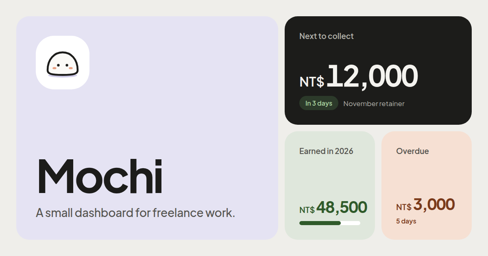

# Mochi

Mochi is a small personal dashboard I made for myself for freelance work.

- **Projects**: track each project, its price and paid additions, and what's been paid.
- **Clients**: keep their contact methods (Discord, LINE, email) and message them in one click.
- **Retainers**: monthly maintenance fees, with Discord reminders when it's time to collect.
- **Overview**: what to collect next, what's overdue, and what you've earned this year.
- **MCP**: let AI assistants like Claude use the dashboard.
- **Keni sync**: record the money you receive as income in [Keni](https://keni.seria.moe).
- **Installable**: works as an app on your phone, in light or dark mode.

- `backend/`: FastAPI, SQLAlchemy, Alembic, PostgreSQL (Python, managed with uv)
- `frontend/`: React, Vite, TypeScript (managed with bun)

## Development

Requires Docker, [uv](https://docs.astral.sh/uv/) and [bun](https://bun.sh/).

```sh
docker compose up -d db              # PostgreSQL on localhost:5433

cd backend
cp .env.example .env                 # then set AUTH_PASSWORD_HASH, ENCRYPTION_KEY, and COOKIE_SECURE=false
uv run python -m app.passwords hash-password
uv run alembic upgrade head
uv run uvicorn app.main:app --reload # API on localhost:8000

cd frontend
bun install
bun run dev                          # app on localhost:5173, proxies /api to the backend
```

Tests: `cd backend && uv run pytest`. Lint and format the backend with `uv run ruff check .` and `uv run ruff format .` (settings in `backend/ruff.toml`), and type-check it with `uv run pyright`. Lint and type-check the frontend with `bun run lint` and `bun run build`.

## Login

The dashboard has one user and a password. `backend/.env` holds only its scrypt hash, `AUTH_PASSWORD_HASH`, printed by `uv run python -m app.passwords hash-password`; without one, nobody can log in. Logging in sets an HttpOnly, SameSite=Lax session cookie that lasts 30 days from the last visit. Setting a new hash logs out every session.

## MCP

AI assistants such as Claude can use the dashboard through MCP at `<API URL>/mcp`, e.g. `http://localhost:8000/mcp` in development. They get tools for clients, projects, maintenance fees, earnings and settings. Add it as a remote (streamable HTTP) MCP server. In Claude Code, for example: `claude mcp add --transport http dashboard https://api.example.com/mcp`.

Clients sign in with OAuth: on connecting, the browser opens a page on the dashboard, after the login screen if needed, that names the client and where access goes. Allow sends the client back with access. Access tokens last an hour and refresh for up to 30 days of disuse. Setting a new password hash ends every client's access, as it does browser sessions. Sign-in requests wait in memory for 10 minutes, so restarting the API drops any that are in progress.

## Keni

Settings can connect [Keni](https://keni.seria.moe), a personal finance tracker, with a Keni URL, a personal API token (Keni's Settings › API tokens), and a wallet and category picked from your Keni account. The money you receive is then recorded there as income: project and addition payments, recorded maintenance payments, and auto transfers once their due date is reached. The wallet and category can be changed later; that applies to income sent from then on. Edits and deletes follow, including payments deleted with their project, client or retainer. Money received before connecting stays out, as does a transaction you delete in Keni.

The API syncs once a minute, in the same loop as the reminders. When Keni can't be reached or refuses a change, Settings shows why and the next minute retries. Amounts are sent as NT$ whatever the wallet's currency. The token is stored encrypted with `ENCRYPTION_KEY`.

## Deployment

### Docker Compose

`docker-compose.yml` runs the whole app on one origin: PostgreSQL, the API, and nginx serving the frontend and passing `/api`, `/mcp` and the OAuth routes to the API. Copy `.env.example` to `.env` and fill it in, then run `docker compose up -d --build`. The app is on port 8080; put your own reverse proxy in front of it for HTTPS. Behind one, the login throttle sees the proxy's IP for every client.

Pushes to `main` and `v*` tags also publish both images to `ghcr.io/seriaati/mochi-backend` and `ghcr.io/seriaati/mochi-frontend`.

### Cloudflare Pages and a separate API

With the frontend on Cloudflare Pages at `dash.example.com` and the API at `api.example.com`:

- Frontend build: `VITE_API_URL=https://api.example.com` (see `frontend/.env.example`).
- API: `AUTH_PASSWORD_HASH`, `ENCRYPTION_KEY` (encrypts the Discord webhook URL and bot token, which are set in Settings with your Discord user ID, and the Keni API token), `FRONTEND_ORIGIN=https://dash.example.com`, `COOKIE_DOMAIN=.example.com` and, for MCP, `PUBLIC_URL=https://api.example.com` (see `backend/.env.example`). Keep `COOKIE_SECURE` on. MCP sign-in sends the browser to the first `FRONTEND_ORIGIN`.
- API image: `docker build -t freelance-backend backend`, then `docker run -d -p 8000:8000 --env-file backend/.env freelance-backend`. It runs `alembic upgrade head` on start, exiting if that fails, and its healthcheck calls `/api/health`, which returns 503 when the database is unreachable. Run a single container: the reminder loop (which also syncs to Keni) and login throttle live in one process.
- Login attempts are throttled per client IP. Behind a reverse proxy, run uvicorn with `--proxy-headers --forwarded-allow-ips=<proxy IP>` so it sees real client IPs, not the proxy's.
